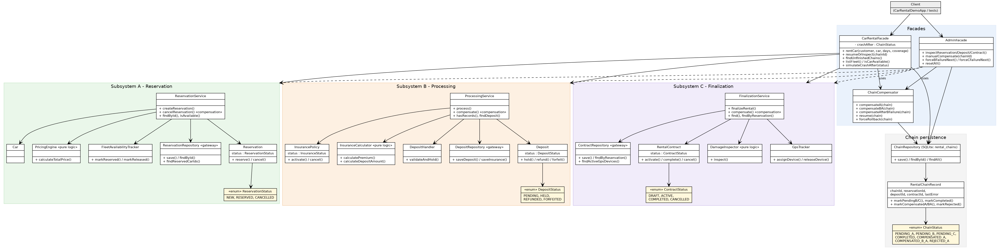

# Assignment 4 — Facade over a Three-Stage Chain (Car Rental)

**Student:** Utembayeva Karakat  
**Group:** SE-2535  
**Domain:** Car Rental (variant 13)  
**GitHub repository:** 

## 1. Overview

A Facade layer over three independent subsystems: **A** (reservation + pricing) → **B** (insurance + deposit) → **C** (damage inspection + GPS). `CarRentalFacade.rentCar(...)` runs the chain as one operation; `AdminFacade` is the second, narrower facade (inspection, manual compensation, reset). State and chain progress are stored in SQLite (`car_rental.db`). If B fails after A, only A is compensated; if C fails after A and B, B and then A are compensated.

## 2. Build, run, reset

```bash
mvn clean package                                # compile + tests + jar
java -jar target/car-rental-facade-1.0.0.jar     # or: mvn exec:java
mvn verify                                       # tests + JaCoCo (>= 80 %), report: target/site/jacoco/index.html
```

**Reset the store to a clean state:** menu option 9 in the demo, or delete the file `car_rental.db`.

Demo menu: 1 fleet · 2 rent (A→B→C) · 3 B fails (compensate A) · 4 C fails (compensate B, then A) · 5 inspect chains · 6 inspect reservation/deposit/contract · 7 manual compensation · 8 recover after restart · 9 reset · 10/11 kill the process after A / after B · 0 exit.

## 3. Principle of Least Knowledge — before / after

**Before** (no facade): the client talks to three services, knows A's internals and decides the compensation depth itself.

```java
ReservationService a = ...;  ProcessingService b = ...;  FinalizationService c = ...;

Reservation r = a.createReservation(customer, carId, days);
try {
    Car car = a.getFleet().get(carId);
    Deposit d = b.process(r.getReservationId(), customer,
                          car.getCategory(), days, r.getTotalPrice(), coverage);
    RentalContract k = c.finalizeRental(r.getReservationId(), customer, carId);
} catch (ResourceUnavailableException e) {
    if (/* only A committed */) a.cancelReservation(r.getReservationId());
    else { b.compensate(r.getReservationId()); a.cancelReservation(r.getReservationId()); }
}
```

**After** (with the facade): one friend.

```java
CarRentalFacade facade = ...;
RentalChainRecord result = facade.rentCar(customer, carId, days, coverage);
// result.getStatus(): COMPLETED / COMPENSATED_A / COMPENSATED_B_A — compensation is already done
```

## 4. Facade vs Adapter

An Adapter makes an existing class fit an interface a client already expects; its intent is translation. Here nothing needs translating: `ReservationService`, `ProcessingService` and `FinalizationService` each have a clean API, and no client expects a different one.

What the client really wants is one operation, "rent a car", that spans three subsystems, fixes the order of the calls, and cleans up the right part when B or C fails. Hiding a group of collaborating subsystems behind one simpler, higher-level interface and coordinating them is the intent of Facade. Wrapping each service in an Adapter would still leave the client to sequence the calls and choose the compensation depth.

## 5. UML class diagram



Files: `docs/uml-class-diagram.svg` (vector), `docs/uml-class-diagram.png`, source `docs/uml-class-diagram.dot`. There are no arrows between A, B and C.
